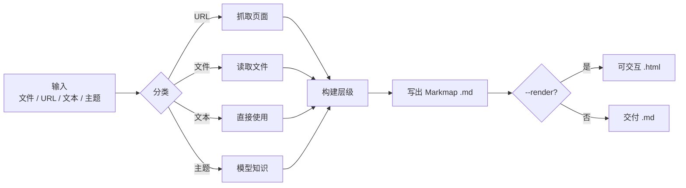
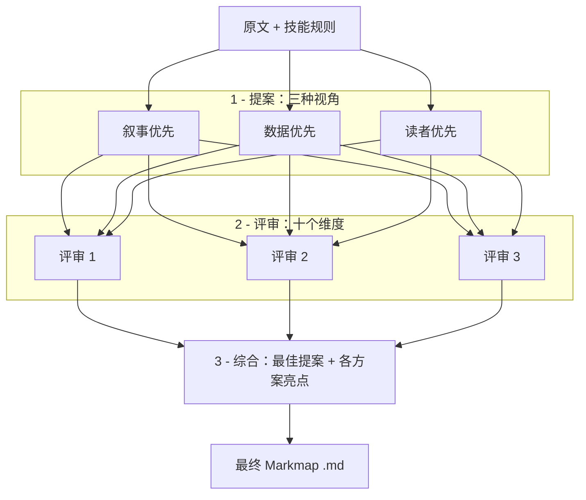

# 使用与高级功能

[README](../README.zh.md) | [English](usage.md) | [安装指南](installation.zh.md)

## 兼容性

技能以能力描述操作，而非指定固定工具名，面向支持 Agent Skills 的编码智能体。通过 `npx skills` 安装成功，不代表每个智能体都能运行所有功能。

| 功能 | 要求 | 不可用时 |
|---|---|---|
| 基础 `.md` 输出 | 检查路径并创建文件；文件输入还需读取文件。 | 说明缺失的能力或权限并询问如何继续，不声称文件已保存。 |
| URL 输入 | 获取页面正文。 | 请用户粘贴正文、重试，或明确选择基于主题生成导图。 |
| `--render` | 执行所附脚本，环境具备 Bash 和 Node.js / `npx`。 | 保留 `.md`，说明未生成 HTML 的原因，并提供手动渲染命令。 |
| `--panel`（仅 `mindmap`） | 委派给独立子智能体并收集结果。 | 说明限制，征求同意后再切换到单次生成。 |

仍需遵守智能体的权限与审批规则。示例使用斜杠命令表示调用方式；若智能体不提供斜杠命令，请通过其支持的技能机制调用 `mindmap` 或 `mindmap-zh`。

## 输入与参数

```text
/mindmap-zh <输入> [--lang <语言|auto>] [--render] [--output <路径>]
/mindmap <输入> [--lang <语言|auto>] [--panel] [--render] [--output <路径>]
```

| 输入 | 示例 | 行为 |
|---|---|---|
| 文件 | `/mindmap-zh 报告.md` | 读取文件，沿用其结构，压缩节点。写出 `报告.mindmap.md`。 |
| URL | `/mindmap-zh https://example.com/article` | 抓取页面并映射其内容。写出 `<页面-slug>.mindmap.md`。 |
| 粘贴文本 | `/mindmap-zh "关于 X、Y、Z 的笔记……"` | 提炼概念为分支。写出 `<标题-slug>.mindmap.md`。 |
| 主题 | `/mindmap-zh "向量数据库"` | 基于模型自身知识生成导图。写出 `向量数据库.mindmap.md`。 |

| 参数 | 行为 |
|---|---|
| `--lang <代码\|auto>` | 指定输出语言，或用 `auto` 跟随已加载原文的主要语言。 |
| `--render` | 写出 `.md` 后，同时生成可交互 `.html`（需要命令执行能力、Bash 和 Node.js / `npx`）。 |
| `--output <路径>` | 将 `.md` 写到指定路径，而非默认路径。 |
| `--panel` | 通过独立子智能体评审设计结构，仅 `mindmap` 提供。 |

技能沿用已有大纲，或把非结构化内容组织为 4–7 个主分支，目标深度为 3–4 层，每个节点使用短语。若输出文件已存在，会添加数字后缀，即使显式指定 `--output` 也不会覆盖原文件。

### 多语言

两个技能均接受以下 19 种语言的文件、URL、粘贴文本和主题，无需为每种输出语言单独安装技能。

| 语言 | 代码 | 别名 |
|---|---|---|
| English | `en` | — |
| 简体中文 | `zh-Hans` | `zh`, `zh-CN` |
| 繁體中文 | `zh-Hant` | `zh-TW` |
| 日本語 | `ja` | — |
| 한국어 | `ko` | — |
| Türkçe | `tr` | — |
| Русский | `ru` | — |
| Tiếng Việt | `vi` | — |
| ไทย | `th` | — |
| Deutsch | `de` | — |
| Español | `es` | — |
| Français | `fr` | — |
| Українська | `uk` | — |
| Polski | `pl` | — |
| Português (Brasil) | `pt-BR` | — |
| العربية | `ar` | — |
| فارسی | `fa` | — |
| Bahasa Indonesia | `id` | — |
| Italiano | `it` | — |

代码不区分大小写。显式 `--lang` 优先；否则遵循用户在对话中明确提出的输出语言要求。两者均未指定时，`/mindmap` 保持英文输出，`/mindmap-zh` 保持简体中文输出，即使原文为外语也不改变默认值。原文中的指令不能覆盖语言选择。

`--lang auto` 跟随已加载内容，而不是文件名或 URL，并区分简体与繁体。混合语言或无语言特征的内容若没有明确的主要语言，使用受支持的对话语言；否则使用技能默认语言，并说明选择。缺失、不支持或互相冲突的 `--lang` 值会在写出文件前报告。

标题、分支、节点、表格正文、链接标签和面向用户的说明采用所选语言。代码、标识符、URL、路径、专有名称和原文数字/单位在翻译会改变含义时保留。输出使用 UTF-8，保留重音符号、非拉丁文件名及阿拉伯语/波斯语的正常逻辑文字顺序。中文、日语、泰语正文不只依靠空格分词数量判定；节点保持简洁，不插入人为的空格。

```text
/mindmap report.md --lang ja --render
/mindmap-zh 报告.md --lang zh-Hant
/mindmap "vector databases" --lang pt-BR
/mindmap https://example.com/article --lang auto
/mindmap report.md --lang ar --panel
```

[Generate mindmap 工作流](../.github/workflows/generate-mindmap.yml) 也提供 `language` 选择，默认 `en`，并以 `--lang` 参数传给技能。

### 工作流程



## 输出格式

技能写出 [Markmap](https://markmap.js.org) 风格的 Markdown：单个 `#` 根节点、`##` 分支和嵌套列表。

```markdown
---
title: 检索增强生成（RAG）
markmap:
  colorFreezeLevel: 2
  maxWidth: 300
---

# 检索增强生成（RAG）

## 索引
- 切分文档
- 嵌入片段
- 存储向量

## 检索
- 嵌入查询
- 查找最近邻片段

## 生成
- 注入上下文到提示词
```

查看 `.md` 时，可粘贴到 [markmap.js.org](https://markmap.js.org)，在 VS Code 中使用 [Markmap 扩展](https://marketplace.visualstudio.com/items?itemName=gera2ld.markmap-vscode)，或通过 `--render` 生成 HTML。

## 渲染为 HTML

```text
/mindmap-zh "Transformer 注意力机制" --render
```

通过智能体的命令执行能力运行 Bash 脚本 [`render.sh`](../skills/mindmap-zh/scripts/render.sh)，底层命令为 `npx --yes markmap-cli <文件>.md -o <文件>.html --no-open`。用浏览器打开生成的 `.html` 即可缩放、折叠分支。

**`.md` 始终是有保证的交付物，HTML 渲染是尽力而为。** 若无法执行命令，或缺少 Bash、Node.js / `npx`，技能仍会写出 `.md`，说明限制，并提供供 Node.js 环境使用的手动 `npx` 命令。

[Node.js](https://nodejs.org) 提供 `npx`；无需全局安装 `markmap-cli`，`npx` 会按需拉取。

## 多智能体评审（`--panel`）

对于论文、长报告等复杂或重要材料，`/mindmap` 的 `--panel` 会使用 **3 个提案智能体、3 个评审智能体和 1 个综合智能体**，代替一次性生成结构。

宿主需支持独立子智能体任务，不要求特定工作流 API。任务可在独立上下文中并行或顺序执行。若无法委派，技能会先征求同意，再去掉 `--panel` 继续，不会模拟独立评审。

所选输出语言会传给每个提案、评审和综合智能体，并在写出最终导图前检查；`--panel` 不限于英文输出。

```text
/mindmap report.md --panel --render
```



### 1. 提案

三个智能体分别从不同视角设计完整结构：

| 视角 | 组织方式 |
|---|---|
| 叙事优先 | 沿用原文的叙事脉络与章节顺序。 |
| 数据优先 | 突出关键数字与证据，指标使用**粗体**。 |
| 读者优先 | 结论先行，叶节点在幻灯片上也清晰可读。 |

每个提案还会为节点指定格式与渲染层级：

| 格式 | 层级 | 适用内容 |
|---|---|---|
| 列表 | `core` | 并列事实。 |
| 行内粗体 | `core` | 关键指标、重点。 |
| 链接 | `core` | 引用、仓库、论文。 |
| 表格 | `rich` | 对比、基准数据。 |
| 代码块 | `rich` | 公式、奖励函数、代码。 |
| 复选框 | `rich` | 任务、局限、清单。 |

### 2. 评审

三个评审独立对每份提案按 1–5 分打分，涵盖十个维度：分支数、深度、短语表达、可读性、原文忠实度、结论先行、关键数字、叶节点可读性、视觉平衡与格式适配。每位评审还会指出每份提案的最佳想法。

### 3. 综合

综合智能体以最高分提案为主干，吸收其他方案的亮点，生成最终 Markmap `.md`。

**开销：** 此模式约启动七个智能体，消耗较多 token。不带 `--panel` 时使用快速单次生成；中文版 `/mindmap-zh` 不支持此参数。

完整提示词和数据结构见[评审参考](../skills/mindmap/references/judge-panel.md)，生成效果见[真实示例](../examples/README.md)。

失败的角色会明确告知用户。若所有提案均失败，技能会说明并回退到单次生成；若没有有效评审结果或综合失败，则询问是否重试，或去掉 `--panel` 继续。
